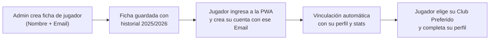
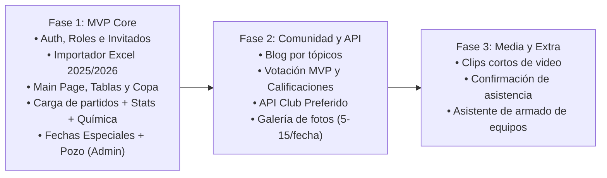

# Documentación de Negocio y Producto — LolonmeApp

> [!IMPORTANT]
> **Propósito de este documento**: Definir el alcance funcional, los roles, los flujos de usuario, la arquitectura de costo \$0 y el plan de entregas de **LolonmeApp**, para validar toda la configuración junto con el Presidente de LOLONMEBOL antes de pasar al diseño técnico y programación.

---

## 1. Visión del Producto

**LolonmeApp** es el hub digital **mobile-first** (Web App instalable — **PWA**) del torneo de fútbol **LOLONMEBOL**. Su objetivo es:

1. **Centralizar la gestión del torneo** (fechas, formaciones, resultados, Liga, Copa, Final LOLONMEBOL, fechas especiales y Pozo) eliminando errores manuales de planillas.
2. **Potenciar la experiencia de los jugadores** con estadísticas personales, filtros grupales avanzados (Química, Consistencia Wilson, Historial H2H), club preferido en vivo, blog comunitario, votaciones y galería de partidos.
3. **Mantener \$0 de costo fijo de mantenimiento**, sin depender de tiendas (Play Store / App Store) y con despliegue automático.
4. **Asegurar continuidad histórica** mediante un **importador constante desde Excel** compatible con `LOLONMEBOL.xlsx` (temporadas 2025, 2026 y futuras).

---

## 2. Roles y Matriz de Permisos

El **Admin es a su vez Jugador** (participa en el torneo y tiene sus propias estadísticas). Además, el Admin puede delegar permisos de carga de partidos a **Jugadores Autorizados**.

| Funcionalidad / Módulo | Admin *(también Jugador)* | Jugador Autorizado | Jugador | Invitado *(sin cuenta)* |
| :--- | :---: | :---: | :---: | :---: |
| Ver Main Page (Anuncios, Calendario, Tablas, Cruces de Copa) | Sí | Sí | Sí | **Sí** |
| Ver perfiles, stats personales y filtros grupales de jugadores | Sí | Sí | Sí | **Sí (solo lectura)** |
| Leer el Blog de jugadores | Sí | Sí | Sí | **Sí (solo lectura)** |
| Crear tópicos y participar/comentar en el Blog | Sí + Moderar | Sí | Sí | No |
| Editar su propio perfil y elegir **club preferido** | Sí | Sí | Sí | No |
| Votar **MVP** y **calificaciones** de un partido | Sí | Sí | Sí | No |
| Confirmar asistencia a eventos *(cuando se habilite)* | Sí | Sí | Sí | No |
| Subir **fotos** (y clips cortos en fase futura) a partidos | Sí + Moderar | Sí | Sí | No |
| Cargar/editar **partidos** (formaciones, resultados, G/A, notas, MVP) | Sí | **Sí** | No | No |
| Gestionar **jugadores** (crear con email, roles, delegar permisos) | **Sí** | No | No | No |
| Gestionar **Anuncios, Calendario, Fechas Especiales y Copas** | **Sí** | No *(a validar)* | No | No |
| **Importador constante desde Excel** | **Sí** | No | No | No |
| **Pozo y Premios** (cuotas, gastos, rendimientos, saldo) | **Sí (exclusivo)** | No | No | No |

### Flujo de alta y vinculación de jugadores

- No requiere envío automático de correos de invitación: alcanza con que el jugador se registre (con Google o email/contraseña) usando el mismo mail cargado por el Admin.

---

## 3. Módulos y Alcance Funcional

### 3.1 Main Page (Inicio)
Diseñada para consumo rápido desde el celular:
- **Tablero de Anuncios**: Avisos fijados por el Admin (cambios de cancha, horarios, comunicados del Presidente, recordatorios).
- **Calendario de Eventos (informativo inicialmente)**: Vista mensual/agenda con **etiquetas de color** por tipo de evento (`Liga`, `Copa`, `Final LOLONMEBOL`, `F11 Especial`, `Descanso`, `Partido Aplazado`).
- **Tablas de Posiciones**: Selector rápido entre **Tabla Anual** (temporada activa) y **Tabla Histórica** (acumulado total), con zonas visuales de clasificación.
- **Cruces de Copa y Final LOLONMEBOL**: Cuadro visual interactivo (Fase Previa → Cuartos → Semis → Final → LOLONMEBOL) generado automáticamente según las reglas validadas de la tabla.
- **Resumen de Clubes Preferidos**: Widget compacto con resultados recientes / próximos partidos de los clubes elegidos por los jugadores.

### 3.2 Partidos y Fechas Especiales
- **Detalle de cada fecha (Liga / Copa)**: Fecha, modalidad (`F5`/`F6`/`F7`), formaciones de ambos equipos, resultado, si es Copa (capitanes y marcador global), MVP(s), Goles/Asistencias y Calificaciones.
- **Sección aparte de Fechas Especiales**: Historial dedicado para eventos fuera de Liga (ej. *F11 Aniversario*, *F11 Oktubre*, *F11 Despedida*), vinculados a su vez con el Calendario mediante etiquetas.
- **Participación post-partido**:
  - Votación de **MVP** y **calificaciones** por parte de los jugadores.
  - Galería del partido: carga de **5 a 15 fotos** por partido (compresión automática). Los **clips cortos de video** quedan planificados para una fase posterior para resguardar el costo \$0.

### 3.3 Hub de Jugadores y Estadísticas
- **Perfil de Jugador**:
  - Nombre, apodo, foto/avatar, estrellas/títulos ganados.
  - **Club preferido** (integrado con API de fútbol): escudo del club, último resultado y próximo partido.
  - Resumen de temporada e histórico: Posición, `Pts`, `PJ`, `PG%`, `MVPs`, `G`, `A`, `G/A`, promedio de calificación y evolución fecha a fecha.
- **Estadísticas Grupales con Filtros**:
  - Comparador y explorador filtrable por **jugador(es)**, **temporada** y **modalidad (`F5`/`F6`/`F7`)**:
    - **Química (%)** y **Consistencia Wilson (`CT%`)** con cada compañero.
    - **Mejores y peores duplas** (con filtro de mínimo de partidos compartidos).
    - **Historial mano a mano (`V - D`)** enfrentándose como rivales.
    - Rendimiento de subgrupos específicos (ej. *"¿Cómo nos fue cuando jugamos juntos A, B y C?"*).

### 3.4 Blog de Jugadores
- **Una sola pestaña/sección global** (no un muro individual por jugador).
- Organizado en **tópicos creados por los propios usuarios** (ej. *Crónicas de fechas*, *Debates de reglamento*, *Cargadas y memes*, *Mercado de pases*, *Asados / F11*).
- Los jugadores crean tópicos y responden; los invitados pueden leer todo sin participar; el Admin tiene permisos de moderación.

### 3.5 Panel de Administración
- **Gestión de Partidos** *(Admin + Jugadores Autorizados)*: Carga rápida mobile-first de equipos, goles/asistencias, marcador, MVP y calificaciones; recálculo inmediato de todas las tablas y matrices.
- **Gestión de Jugadores y Roles** *(solo Admin)*: Alta con email, asignación de permisos (`admin`, `autorizado`, `jugador`), gestión de estrellas/títulos y fusión de invitados ocasionales.
- **Pozo y Premios** *(solo Admin)*: Control de cuotas mensuales por jugador, registro de gastos/premios, rendimientos y cálculo automático del saldo total.
- **Importador Constante desde Excel** *(solo Admin)*:
  - Permite subir `LOLONMEBOL.xlsx` de forma recurrente (tanto para la migración inicial de 2025/2026 como para sincronizaciones futuras).
  - **Normalización inteligente**: limpia inconsistencias de texto/emojis (ej. `B. Aguzzi ⭐⭐⭐` vs `B. Aguzzi ⭐️⭐️⭐️`, que en Excel generan desvíos) y mapea contra los IDs internos de jugadores.
  - **Pantalla de vista previa (dry-run)**: muestra partidos nuevos, modificados o con conflictos antes de confirmar la importación.

---

## 4. Propuesta Tecnológica (Costo \$0/mes)

| Componente | Tecnología | Plan y estrategia para garantizar costo \$0 |
| :--- | :--- | :--- |
| **App Mobile-First (PWA)** | Next.js (App Router) + TypeScript + Tailwind CSS + shadcn/ui | Instalable en Android/iOS sin tiendas (evita US\$99/año Apple + US\$25 Google). |
| **Hosting & Deploy** | Vercel (Hobby Plan) | \$0/mes, deploy continuo directo desde `LucaOlivieri03/LolonmeApp` en GitHub. |
| **Base de Datos + Auth** | Supabase (Free Tier — PostgreSQL) | 500 MB DB + Auth + Row Level Security para roles. Un cron semanal gratuito de GitHub Actions evita la pausa por inactividad. |
| **Imágenes (5–15 fotos/partido)** | Cloudinary (Free Tier) | 25 créditos/mes con compresión automática a WebP y redimensionado mobile. |
| **Clips de video (Fase 3)** | Cloudflare R2 (10 GB gratis, \$0 egreso) o links YouTube No Listado | Evita costos por ancho de banda cuando se incorporen clips cortos. |
| **API de Fútbol (Club preferido)** | API-Football (API-Sports Free: 100 req/día) | Cubre Liga Argentina, Libertadores y ligas del mundo. Se **cachea en Supabase** (1–2 consultas/día solo para los clubes elegidos por jugadores), consumiendo muy por debajo del límite gratuito. |

---

## 5. Hoja de Ruta Sugerida por Fases

---

## 6. Checklist de Decisiones de Negocio a Validar

Puntos operativos para confirmar antes de pasar al diseño de base de datos y pantallas:

- [ ] **Votación de MVP y Calificaciones**:
  - ¿Pueden votar todos los jugadores registrados o **solo los que jugaron esa fecha**?
  - ¿Un jugador puede votarse a sí mismo?
  - ¿El promedio de votos se publica automáticamente al cerrar una ventana de tiempo (ej. 48 hs) o requiere **cierre/aprobación del Admin**?
- [ ] **Alcance de los Jugadores Autorizados**: Confirmar si solo cargan/editan **partidos y rendimientos**, o si también pueden crear eventos en el calendario y publicar anuncios.
- [ ] **Conflictos en el Importador constante de Excel**: Si un partido se edita en la app y luego se importa un Excel más nuevo, ¿qué debe suceder? *(Recomendación: mostrar pantalla de comparación y que el Admin elija si sobrescribir o mantener lo de la app).*
- [ ] **Pozo y Premios**: Confirmar que el Pozo es **100% invisible** para jugadores e invitados, o si conviene mostrarle a cada jugador únicamente su propio estado de cuotas (sin ver montos ni gastos globales).
- [ ] **Clubes preferidos (API de fútbol)**: Confirmar si el catálogo debe incluir **clubes de todo el mundo** o acotarse a **Argentina / Sudamérica + principales ligas europeas**, y si el jugador puede cambiar su club luego o solo una vez.
- [ ] **Confirmación de asistencia en Calendario**: Dado que se indicó calendario **informativo por ahora** (punto 12) pero asistencia deseada a futuro (punto 8), confirmar si dejamos **solo informativo en Fase 1** y sumamos **"Voy / No voy"** en Fase 2 o 3.
- [ ] **Subida de fotos por partido**: ¿Puede subir fotos cualquier jugador logueado o solo quienes jugaron ese partido / autorizados? ¿Con límite automático de 15 fotos por partido?
- [ ] **Estética / Identidad visual**: ¿LOLONMEBOL ya tiene logo, paleta de colores (en el Excel predominan violeta para Liga, azul para Copa, rosa para F11 y rojo para LOLONMEBOL) o tipografía que quieran respetar en la app?
