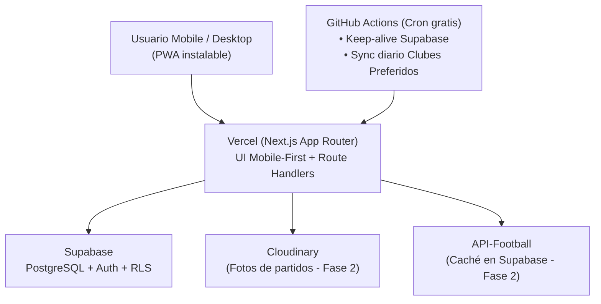

# Plan Técnico y Arquitectura — LolonmeApp

> [!NOTE]
> Documento técnico de referencia basado en el reglamento definitivo (`docs/reglas_torneo_lolonmebol.md`) y la documentación de negocio (`docs/documentacion_negocio_lolonmebol.md`). Refleja la arquitectura implementada en producción (Fase 1 + migración server-first + Google OAuth + Pizarra táctica + Votación post-partido) y el diseño pendiente de Fase 2–3.

---

## 1. Arquitectura General (Costo \$0/mes)



- **Frontend / Full-stack**: Next.js 15 (App Router), React 19, TypeScript, Tailwind CSS v4, Lucide Icons, Recharts, `manifest.json` + service worker ligero para PWA.
- **Identidad visual**: Logo oficial importado desde `assets/` (colocado en `public/assets/` para íconos PWA, favicon y header).
- **Seguridad por roles**: **Row Level Security (RLS)** en PostgreSQL (Supabase) + validación en Server Actions / Route Handlers. Los invitados acceden sin login a las vistas públicas de solo lectura; el módulo de **Pozo** tiene RLS estricto `role = 'admin'`.

---

## 2. Modelo de Datos (PostgreSQL / Supabase)

### 2.1 Usuarios, Jugadores, Vinculación y Títulos
- **`players`**: `id`, `slug` (unique, identificador estable de dominio agregado en `0002`), `user_id` (unique, nullable — se vincula automáticamente al iniciar sesión con Google/OTP con el mismo email), `email` (unique case-insensitive vía `idx_players_email_lower`, nullable; protegido con `REVOKE SELECT (email) ON public.players FROM anon, authenticated`), `display_name`, `nickname`, `avatar_url`, `role` (`admin` | `authorized` | `player`), `favorite_club_id`, `political_orientation` (nullable, agregado en `0002`), `is_active`, `created_at`.
- **`player_link_requests`** *(agregado en `0003`)*: cola de auto-solicitudes de vinculación para usuarios autenticados cuyo email aún no está precargado en `players`.
  - Columnas: `id` (PK), `user_id` (`REFERENCES auth.users(id) ON DELETE CASCADE`), `email`, `requested_player_id` (`REFERENCES public.players(id) ON DELETE CASCADE`), `status` (`pending` | `approved` | `rejected`), `reviewed_by` (`REFERENCES public.players(id) ON DELETE SET NULL`), `review_note`, `created_at`, `reviewed_at`.
  - Índice único parcial: `UNIQUE (user_id) WHERE status = 'pending'` (máximo una solicitud activa por cuenta).
  - RLS: usuarios autenticados solo leen e insertan su propia solicitud `pending` hacia un jugador activo con `user_id IS NULL` y `role <> 'admin'` (y solo si el solicitante no está ya vinculado); únicamente `public.is_admin()` puede listar todas las solicitudes y aprobarlas/rechazarlas.
- **Triggers y RPCs de autenticación (`0001` + `0003`)**:
  - `public.handle_new_auth_user()` (`AFTER INSERT OR UPDATE OF email_confirmed_at, last_sign_in_at ON auth.users`): vincula automáticamente `players.user_id` cuando coincide `lower(email)` en una ficha activa libre y resuelve solicitudes `pending` relacionadas.
  - `public.guard_player_self_update()`: impide que usuarios no-`admin` modifiquen `role`, `email`, `user_id` o `is_active`.
  - `public.admin_list_player_auth_links()` (`SECURITY DEFINER`, `REVOKE ALL FROM PUBLIC, anon`, `GRANT EXECUTE TO authenticated`, guarda `public.is_admin()`): expone `(player_id, player_slug, email, is_linked)` exclusivamente para el panel `/admin` sin otorgar `SELECT (email)` directo ni filtrar `user_id`.
- **`player_aliases`**: `id`, `player_id`, `raw_name` — mapea variantes del Excel (ej. `B. Aguzzi ⭐⭐⭐`, `B. Aguzzi ⭐️⭐️⭐️`, `Pipo ⭐`) al mismo `player_id` para el importador constante.
- **`player_titles`**: `id`, `player_id`, `season_id`, `title_type` (`league` | `cup` | `lolonmebol`), `awarded_at` — cada fila equivale a `1 ⭐` en el perfil.

### 2.2 Temporadas, Calendario y Anuncios
- **`seasons`**: `id`, `year` (2025, 2026...), `name`, `status` (`active` | `finished`), `cup_cutoff_date`.
- **`calendar_events`**: `id`, `season_id`, `title`, `description`, `event_date`, `event_type` (`league` | `cup` | `lolonmebol` | `special_f11` | `rest` | `postponed`), `match_id` (nullable), `created_by`.
- **`announcements`**: `id`, `title`, `body`, `is_pinned`, `created_by`, `created_at`, `updated_at`.

### 2.3 Partidos, Participaciones y Votaciones
- **`matches`**:
  - `id`, `slug` (unique, `0002`), `season_id`, `match_number` (nullable para F11), `match_date`, `match_type` (`league` | `cup` | `lolonmebol` | `special_f11` | `league_tiebreaker`), `modality` (`F5` | `F6` | `F7` | `F11`), `team_a_score`, `team_b_score`, `result_outcome` (`'A'` | `'B'` | `'draw'`, nullable — agregado en `0002` para partidos históricos sin marcador exacto).
  - Flags configurables para excepciones: `counts_for_league` (bool), `counts_for_stats` (bool) — permite manejar `F11 Aniversario 2025` sin lógica hardcodeada.
  - Votación: `voting_status` (`open` | `closed`), `voting_closed_at`, `voting_closed_by`.
  - Sincronización Excel: `external_source_key` (para detectar actualizaciones en el importador constante).
- **`match_players`**:
  - `id`, `match_id`, `player_id`, `team` (`A` | `B`), `is_cup_captain` (bool), `goals`, `assists`, `admin_rating` (numeric, nullable), `is_mvp` (bool — oficial, con soporte de override y MVP compartido).
- **`match_votes`** *(Fase 2 — transparente)*:
  - `id`, `match_id`, `voter_player_id` *(validado: debe existir en `match_players` de ese partido)*, `target_player_id`, `rating` (numeric 1–10), `voted_mvp` (bool), `created_at`.

### 2.4 Motor de Copa (Automático + 100% Editable)
- **`cup_editions`**: `id`, `season_id`, `name`, `cutoff_snapshot_json` *(guarda el orden de la tabla al momento del corte para la ventaja deportiva)*.
- **`cup_ties`**:
  - `id`, `cup_edition_id`, `round` (`preliminary` | `quarterfinal` | `semifinal` | `final` | `lolonmebol`), `slot_order`.
  - `player_a_id`, `player_b_id` *(editables por Admin para bajas/reemplazos)*.
  - `seed_a`, `seed_b` *(para ventaja deportiva en empate global)*.
  - `leg1_match_id`, `leg2_match_id` *(nullable)*.
  - `override_score_a`, `override_score_b` *(nullable — permite al Admin ajustar puntaje si hace falta)*.
  - `winner_player_id` *(calculado automáticamente o sobreescrito por Admin)*, `notes` *(ej. "Baja de Porpo por lesión, ingresa Pedro")*.

### 2.5 Pozo y Premios (Solo Admin — RLS estricto)
- **`fund_months`**: `id`, `season_id`, `month_number`, `month_label`, `fee_amount` *(cuota configurable por mes)*.
- **`fund_payments`**: `id`, `fund_month_id`, `player_id`, `paid` (bool), `paid_at`.
- **`fund_transactions`**: `id`, `season_id`, `tx_type` (`expense` | `yield`), `amount`, `description`, `tx_date`.

### 2.6 Blog, Media y API de Fútbol (Fase 2–3)
- **`blog_topics`**: `id`, `title`, `body`, `category_tag`, `author_player_id`, `is_pinned`, `created_at`.
- **`blog_comments`**: `id`, `topic_id`, `author_player_id`, `body`, `created_at`.
- **`match_media`**: `id`, `match_id`, `media_type` (`photo` | `video`), `url`, `uploaded_by`, `created_at`.
- **`clubs_cache`**: `club_id`, `name`, `logo_url`, `league_name`, `last_match_json`, `next_match_json`, `synced_at`.

### 2.7 Migraciones SQL (`supabase/migrations/`)

| Archivo | Alcance |
| :--- | :--- |
| `0001_initial_schema.sql` | Esquema base, enums, RLS por rol (`is_admin()`, `is_operator()`), `REVOKE SELECT (email)` y trigger inicial `handle_new_auth_user()` |
| `0002_align_domain_and_historical_outcomes.sql` | `players.slug`, `players.political_orientation`, `matches.result_outcome` y claves externas naturales para sync idempotente con Excel |
| `0003_player_link_requests.sql` | Tabla `player_link_requests` + índice único parcial `pending` + RLS, unicidad case-insensitive de `players.email`, hardening de `handle_new_auth_user()` y RPC `admin_list_player_auth_links()` |

---

## 3. Motores de Cálculo (SQL Views / Funciones en TypeScript)

1. **Tabla Anual e Histórica**:
   - Calcula `Pts` (`3/1/0` Liga y desempate; `4/2/0` compañeros en Copa; `0` capitanes en Copa y Final LOLONMEBOL), `PJ`, `PG`, `PE`, `PP`, `PG%`, `MVPs`, `G`, `A`, `G/A`, `Calificación Promedio`.
   - Aplica la cadena exacta de desempates: `Pts ↓` → `PJ ↑` → `H2H directo ↓` → `PG% ↓` → `MVPs ↓` → `Nombre ↑`.
   - Señala automáticamente si existe empate en puntos entre `1.°` y `2.°` al cierre de temporada para habilitar el **Partido Desempate de Liga**.
2. **Motor de Copa**:
   - Al generar la Copa: toma los 2 finalistas de la LOLONMEBOL anterior + completa con el Top de la tabla al corte hasta 9 jugadores; coloca en **Fase Previa** a los 2 últimos clasificados que no sean dichos finalistas, y arma Cuartos (`1° vs GFP`, `2° vs 7°`, `3° vs 6°`, `4° vs 5°`).
   - Cada llave permite **edición manual total** por el Admin (cambiar jugador por baja, editar marcador global o elegir ganador).
3. **Química, Consistencia Wilson e Historial H2H**:
   - Calculados dinámicamente desde `match_players` + `matches` (donde `counts_for_stats = true`), filtrables por **temporada o histórico**, **modalidad (`F5`/`F6`/`F7`)** y **subconjunto de jugadores**.
   - Implementa la fórmula exacta de Wilson ($z = 1.28$) y un toggle opcional de *Efectividad 3/1/0*.

---

## 4. Diseño del Importador Constante de Excel

- **Entrada**: Archivo `.xlsx` con el formato actual de `LOLONMEBOL.xlsx` (`Fechas XX`, `Liga XX y Copa XX`, `Rendimientos XX`, `Pozo y premios XX`).
- **Flujo en 3 pasos (Admin)**:
  1. **Parseo y normalización**: Lee hojas en el servidor (`xlsx` / `exceljs`), limpia emojis/espacios y resuelve nombres contra `player_aliases`.
  2. **Vista previa (Dry-Run / Diff)**: Muestra cuántos partidos son **nuevos**, cuántos tienen **cambios** respecto a la DB, y si hay **jugadores nuevos** o **conflictos** (el Admin decide si sobrescribir o conservar lo editado en la app).
  3. **Confirmación transaccional**: Inserta/actualiza en bloque y recalcula automáticamente tablas, química y consistencia.

---

## 5. Mapa de Navegación Mobile-First

Barra inferior fija en mobile (`md:hidden`) y navegación inline en desktop (`md+`):

1. **Inicio (`/`)**: Franja de fecha + Pizarrón de anuncios + Tabs rápidos (**Tabla Anual** / **Histórica** / **Copa**).
2. **Partidos (`/partidos`)**: Listado por temporada con filtros (`Liga`, `Copa`, `LOLONMEBOL`, `Fechas especiales`, fecha, N° de fecha, jugador) + ficha expandible con **Pizarra táctica interactiva**, planillas G/A y **Votación post-partido transparente**.
3. **Stats (`/stats`)**: Perfil personal + **Laboratorio Grupal** (Química, Consistencia Wilson, Historial H2H, filtro de competencia y toggle `< 3 PJ`).
4. **Calendario (`/calendario`)**: Calendario mensual con etiquetas por competencia y partidos vinculados.
5. **Perfil (`/perfil`) + accesos secundarios (`/reglas`, `/blog`, `/admin`)**: Login Google OAuth / Magic Link, carnet del jugador, solicitud de vinculación manual, reglamento oficial, blog (Fase 2) y **Panel Admin** para `admin` / `authorized`.

---

## 6. Estructura del Repositorio

```text
LolonmeApp/
├── assets/                     # Logo oficial de LOLONMEBOL
├── docs/                       # Negocio, reglamento, plan técnico y estado del proyecto
├── odd/tasks/                  # Bitácoras y specs de entregas
├── public/                     # Manifest PWA, service worker, audio himno y SVGs
├── src/
│   ├── app/                    # Next.js App Router (/, /partidos, /stats, /calendario, /reglas, /perfil, /blog, /admin, /api, /auth)
│   ├── components/             # UI modular (admin, layout, matches, profile, stats, tournament)
│   ├── lib/
│   │   ├── engine/             # Motores puros: tabla, copa, química, Wilson, Pozo
│   │   ├── excel/              # Parser e importador constante de LOLONMEBOL.xlsx
│   │   ├── matches/            # Display rules y layout/clamping de pizarra táctica
│   │   ├── supabase/           # Clientes server/browser/anon y config
│   │   ├── types/              # Contratos de dominio, view-models y Server Actions
│   │   └── voting/             # Validación y agregación de votación post-partido
│   └── server/
│       ├── actions/            # Next.js Server Actions (matches, voting, players, cup, fund, etc.)
│       ├── admin/              # Lógica core de mutaciones y tests
│       ├── auth/               # Sesión SSR, guards de rol y link requests
│       ├── db/                 # Tipos DB y mappers
│       ├── queries/            # Proyecciones SSR cacheadas por tags y voting queries
│       └── repositories/       # SupabaseTournamentRepository + SeedPublicTournamentRepository
├── supabase/
│   └── migrations/             # SQL de tablas, índices y políticas RLS (0001–0003)
├── PRODUCT.md                  # Contexto de producto
└── DESIGN.md                   # Sistema de diseño oficial
```
