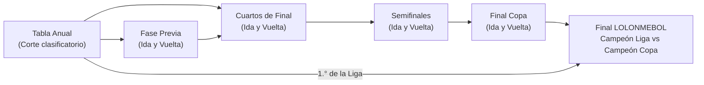

# Reglamento y Reglas de Cálculo — LOLONMEBOL

> [!IMPORTANT]
> **Propósito de este documento**: Consolidar todas las reglas deportivas, fórmulas de cálculo y criterios vigentes relevados de `LOLONMEBOL.xlsx` junto con las definiciones preliminares de la app, para ser **revisado y validado por el Presidente de LOLONMEBOL** antes de iniciar el desarrollo.

---

## 1. Estructura de la Temporada y Competencias

Cada temporada anual (ej. 2025, 2026, 2027) se compone de cuatro tipos de instancias:

| Competencia / Evento | Descripción | Modalidad habitual | ¿Suma en Tabla Anual? |
| :--- | :--- | :--- | :--- |
| **Liga Anual** | Partidos semanales con equipos armados de forma rotativa cada fecha. Puntaje individual. | F5 (base), F6 o F7 | **Sí** |
| **Copa Anual** | Eliminación directa **1 vs 1 entre capitanes** (ida y vuelta), disputada dentro de las fechas semanales con equipos rotativos. | F5 / F6 / F7 | **Sí, solo compañeros** *(capitanes no suman)* |
| **Final LOLONMEBOL** | Superfinal anual entre el **Campeón de Liga** y el **Campeón de Copa**. | Partido definitorio | **A validar** |
| **Fechas Especiales** | Eventos conmemorativos (ej. *F11 Aniversario*, *F11 Oktubre*, *F11 Despedida*), descansos y fechas aplazadas. | F11 u otros | **No** (sección aparte) |

---

## 2. Sistema de Puntajes y Tabla Anual

### 2.1 Tabla de puntos por resultado y rol

De acuerdo con las fórmulas vigentes en `Liga 26 y Copa 26` y las aclaraciones del torneo:

| Tipo de partido | Rol del jugador | Victoria | Empate | Derrota | ¿Suma PJ en Liga? |
| :--- | :--- | :---: | :---: | :---: | :---: |
| **Liga** | Cualquier jugador | **3 pts** | **1 pt** | **0 pts** | Sí |
| **Copa** | Compañero de equipo | **4 pts** | **2 pts** | **0 pts** | Sí |
| **Copa** | Capitán del cruce | **0 pts** | **0 pts** | **0 pts** | **No** |
| **Fecha Especial (F11)** | Cualquier jugador | — | — | — | No |

> [!NOTE]
> **Motivo de la regla de Copa (`4 / 2 / 0`)**: Los puntos extra para los compañeros que acompañan a los capitanes existen para fomentar la asistencia y competitividad durante las fechas de Copa. Los dos capitanes no suman puntos ni PJ en la Tabla de Liga en sus partidos de Copa porque están compitiendo directamente por avanzar en el cuadro de Copa.

### 2.2 Criterios de desempate en la Tabla Anual e Histórica

Fórmula actual del Excel: `PuntajeOrden = Pts × 1.000.000 − PJ × 10.000 − ID_orden`.

1. **Mayor cantidad de Puntos (`Pts`)**.
2. **Menor cantidad de Partidos Jugados (`PJ`)** *(premia mayor efectividad por partido)*.
3. **Tercer criterio** *(a validar — actualmente el Excel desempata por orden alfabético)*.

### 2.3 Tabla Histórica

Acumula de forma continua las estadísticas de todas las temporadas disputadas (`2025 + 2026 + futuras`):
- **Columnas base**: Posición, Jugador, `Pts`, `PJ`, `MVPs` (y palmarés/estrellas).
- **Criterio de orden**: Idéntico a la Tabla Anual (`Pts` descendente, luego `PJ` ascendente).

---

## 3. Formato de la Copa Anual y Final LOLONMEBOL

### 3.1 Dinámica de cada llave de Copa
- Cada cruce enfrenta a **2 jugadores clasificados**, quienes actúan como **capitanes** de equipos rotativos en dos fechas (Ida y Vuelta).
- El marcador del cruce es el **resultado global de goles** de los equipos capitaneados por cada jugador entre la ida y la vuelta *(ej. Copa 26 — Cuartos: Fausto `10 + 11 = 21` vs Gaspi `12 + 5 = 17` → avanza Fausto)*.
- Los demás jugadores que participan en la fecha de Copa reciben el puntaje especial (`4 / 2 / 0`) en la Liga.

### 3.2 Estructura general del cuadro

> [!WARNING]
> **Reglas de Copa pendientes de definición formal**: En el Excel se observan diferencias entre ediciones (*Copa 25* tuvo 8 clasificados directo a Cuartos; *Copa 26* tuvo 9 clasificados con 1 llave de Fase Previa; y existe una mención de posible clasificación de los 12 primeros). Como la app debe **armar los cruces automáticamente según la tabla**, es indispensable validar los puntos de la Sección 6 antes de implementar el motor de llaves.

---

## 4. Rendimientos, MVPs y Estadísticas Avanzadas

### 4.1 Rendimientos partido a partido (`Rendimientos 26`)

Por cada fecha disputada se registran para cada participante:
- **Goles (`G`)** y **Asistencias (`A`)**.
- **Participaciones de gol (`G/A`)**: $\text{G/A} = G + A$.
- **Calificación del partido**: Escala numérica con decimales (ej. `6.5`, `7.25`, `8.5`), mostrando **Promedio** y **Total acumulado** por temporada.
- **MVP de la fecha**: 1 jugador destacado por fecha (puede haber **empate / MVP compartido** entre 2 o más jugadores). En el historial del Excel también se distinguía si el MVP perteneció al equipo ganador, perdedor, empate o si fue capitán de Copa.

### 4.2 Impacto de los Capitanes de Copa en las estadísticas

Relevamiento exacto del comportamiento actual en `LOLONMEBOL.xlsx`:

| Métrica | ¿Cuenta para el Capitán en su partido de Copa? |
| :--- | :---: |
| Puntos (`Pts`) y Partidos Jugados (`PJ`) en **Tabla de Liga** | **No** |
| **Goles (`G`), Asistencias (`A`) y Calificaciones** | **Sí** |
| **MVP de la fecha** | **Sí** |
| **PJ Totales, Química, Consistencia e Historial (`V - D`)** | **Sí** |

### 4.3 Fórmulas de Química, Consistencia e Historial (`Estadísticas 26`)

Todas estas métricas se calculan automáticamente a partir de las formaciones y resultados de cada partido, permitiendo filtrar por modalidad (**F5**, **F6**, **F7** o **Todas**):

1. **Partidos Jugados Juntos ($n_{AB}$)**: Cantidad de partidos en los que el Jugador A y el Jugador B integraron el **mismo equipo**.
2. **Victorias Juntos ($w_{AB}$)**: Cantidad de esos partidos en los que su equipo **ganó**.
3. **Química (%)**: Porcentaje de victorias compartiendo equipo (también aplica a nivel individual como `PG%`):
   $$\text{Química}(A, B) = \frac{w_{AB}}{n_{AB}} \times 100$$
4. **Consistencia (`CT%`)**: Límite inferior del **intervalo de confianza de Wilson al 80%** ($z = 1.28$, $z^2 = 1.6384$). Sirve para rankear duplas y jugadores de forma justa, evitando que alguien con 1 victoria en 1 partido (`100%`) supere a una dupla probada con 9 victorias en 13 partidos (`69.2%`):
   $$\text{CT}(p, n) = 100 \times \frac{\left(p + \frac{0.8192}{n}\right) - 1.28 \sqrt{\frac{p(1 - p)}{n} + \frac{0.4096}{n^2}}}{1 + \frac{1.6384}{n}}$$
   donde $p = \frac{w}{n}$ y $n = \text{PJ}$.
5. **Historial en contra (`V - D`)**: Balance neto enfrentándose en **equipos rivales** (victoria = `+1`, derrota = `-1`, empate = `0`). Es antisimétrico: si $A$ está `+7` sobre $B$, entonces $B$ está `-7` frente a $A$.

---

## 5. Pozo y Premios (Uso exclusivo Admin)

Regla de cálculo actual (`Pozo y premios 26`):

$$\text{Saldo Total} = (\text{Cantidad de cuotas pagas} \times \text{Valor de cuota}) - \sum \text{Gastos / Premios} + \text{Rendimientos}$$

- Permite llevar el estado mensual de pago (`Pagó` / pendiente) por jugador adherido, el detalle de compras/premios (ej. bebidas, trofeos) y rendimientos financieros.
- El valor de cuota puede variar entre temporadas (ej. \$2.000 en 2025, \$3.000 en 2026) o incluso por mes si cambia durante el año.

---

## 6. Checklist de Validación para el Presidente de LOLONMEBOL

Marcar o completar cada definición para cerrar la configuración oficial de la app:

### A. Clasificación y armado automático de la Copa
- [ ] **Cantidad de clasificados**: ¿Cuántos jugadores clasifican a la Copa? (¿8, 9, 12 u otro número?).
- [ ] **Cuándo se hace el corte de tabla**: ¿Se clasifica por la **Tabla Anual del año anterior** (como sugiere la leyenda `Copa 27 - Fase Previa`), o por la **Tabla Anual del año en curso** al llegar a una fecha/mes específico (ej. fin de junio)?
- [ ] **Formato exacto de llaves según clasificados**: Si clasifican 12, ¿quiénes pasan directo a Cuartos (ej. 1.° al 4.°) y quiénes juegan Fase Previa (ej. 5.° vs 12.°, 6.° vs 11.°, 7.° vs 10.°, 8.° vs 9.°)? ¿Cómo se ordenan los cruces de Cuartos y Semifinales (llave fija o re-seeding por tabla)?
- [ ] **Bajas o ausencias en Copa**: Si un jugador clasificado no puede jugar la Copa, ¿entra el siguiente en la tabla (13.°) antes del sorteo/inicio?
- [ ] **Desempate en cruces de Copa**: Si el marcador global ida y vuelta termina empatado, ¿cómo se define al ganador? (ventaja deportiva por mejor ubicación en tabla, penales, gol de oro / partido desempate).

### B. Final LOLONMEBOL y Estrellas (⭐)
- [ ] **Mismo campeón de Liga y Copa**: Si un mismo jugador gana la Liga y la Copa el mismo año, ¿gana automáticamente la LOLONMEBOL o enfrenta al subcampeón de Liga o de Copa?
- [ ] **Puntaje de la Final LOLONMEBOL**: ¿Los compañeros que juegan la Final LOLONMEBOL suman puntos de Liga (`3/1/0` o `4/2/0`) o es un partido fuera de la tabla anual?
- [ ] **Criterio de Estrellas (⭐)**: ¿Qué campeonatos otorgan una estrella en el perfil del jugador? (¿1 estrella por cada Liga, Copa y LOLONMEBOL, o solo por algunos de ellos? Confirmar con las estrellas actuales de `B. Aguzzi ⭐⭐⭐` y `Pipo ⭐`).

### C. Criterios de Desempate y Estadísticas
- [ ] **Tercer criterio de desempate en Tabla**: Si dos jugadores empatan exactamente en `Pts` y en `PJ`, ¿cómo se desempata? (ej. más MVPs, mayor porcentaje de victorias, mejor promedio de calificación, más G/A, o duelo directo).
- [ ] **Capitanes de Copa en estadísticas**: Confirmar que en partidos de Copa los capitanes **NO** suman `Pts`/`PJ` en Tabla de Liga, pero **SÍ** suman en `Goles`, `Asistencias`, `Calificaciones`, `MVPs`, `Química`, `Consistencia` e `Historial`.
- [ ] **Empates en Química y Consistencia**: Confirmar si se mantiene el criterio del Excel (los empates suman en `PJ` pero no en `Victorias`) o si se desea mostrar aparte el porcentaje de efectividad con empates.
- [ ] **Horizonte de Química/Consistencia/Historial**: ¿Queremos poder verlas filtradas **por temporada** (ej. solo 2026) y también en modo **histórico acumulado** (2025 + 2026 + futuras)?
- [ ] **Fechas Especiales (F11)**: Confirmar que los partidos F11 **no** impactan en Liga, Química, Consistencia ni Historial, y solo se muestran en su sección propia y en el perfil como participaciones especiales.

### D. Pozo y Premios
- [ ] **Cuota variable**: ¿El sistema debe soportar cambiar el monto de la cuota mensual durante el año (con historial por mes) para no alterar meses ya cerrados?
