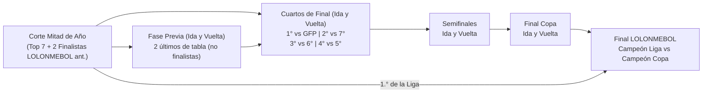

# Reglamento Oficial y Reglas de Cálculo — LOLONMEBOL (v3 — Definitivo)

> [!NOTE]
> **Estado del documento**: Validado integralmente con el Presidente de LOLONMEBOL. Especificación deportiva definitiva para el motor de cálculo y reglas de **LolonmeApp**.

---

## 1. Estructura de la Temporada y Competencias

Cada temporada anual (ej. 2025, 2026, 2027) se compone de cuatro tipos de instancias:

| Competencia / Evento | Descripción | Modalidad habitual | ¿Suma en Tabla Anual? |
| :--- | :--- | :--- | :--- |
| **Liga Anual** | Partidos semanales con equipos armados de forma rotativa cada fecha. Puntaje individual. | F5 (base), F6 o F7 | **Sí** |
| **Copa Anual** | Eliminación directa **1 vs 1 entre capitanes** (ida y vuelta), disputada dentro de las fechas semanales. | F5 / F6 / F7 | **Sí, solo compañeros** *(capitanes no suman)* |
| **Final LOLONMEBOL** | Supercopa anual entre el **Campeón de Liga** y el **Campeón de Copa**, disputada con la tabla ya cerrada. | Partido definitorio | **No** *(tabla ya cerrada)* |
| **Fechas Especiales** | Eventos conmemorativos (ej. *F11 Aniversario*, *F11 Oktubre*, *F11 Despedida*), descansos y fechas aplazadas. | F11 u otros | **No** *(salvo excepción histórica configurable: F11 Aniversario 2025)* |

---

## 2. Sistema de Puntajes y Tabla Anual

### 2.1 Tabla de puntos por resultado y rol

| Tipo de partido | Rol del jugador | Victoria | Empate | Derrota | ¿Suma PJ en Liga? |
| :--- | :--- | :---: | :---: | :---: | :---: |
| **Liga** | Cualquier jugador | **3 pts** | **1 pt** | **0 pts** | Sí |
| **Copa** | Compañero de equipo | **4 pts** | **2 pts** | **0 pts** | Sí |
| **Copa** | Capitán del cruce | **0 pts** | **0 pts** | **0 pts** | **No** |
| **Final LOLONMEBOL** | Cualquier jugador | **0 pts** | **0 pts** | **0 pts** | **No** |
| **Fecha Especial (F11)** | Cualquier jugador | — | — | — | **No** *(configurable por partido)* |

> [!NOTE]
> **Regla de Copa (`4 / 2 / 0`)**: Los puntos extra para los compañeros existen para fomentar la asistencia y competitividad durante las fechas de Copa. Los dos capitanes no suman puntos ni PJ en Liga en sus partidos de Copa.

### 2.2 Criterios de desempate en la Tabla Anual e Histórica

En orden estricto de prioridad:

1. **Mayor cantidad de Puntos (`Pts`)**.
2. **Menor cantidad de Partidos Jugados (`PJ`)**.
3. **Historial directo entre ambos (`V − D`)**.
4. **Mayor porcentaje de victorias (`PG%`)**.
5. **Mayor cantidad de `MVPs`**.
6. **Orden alfabético**.

> [!IMPORTANT]
> **Excepción por el 1.° puesto de la Liga**: Si al finalizar el año hay **empate en puntos entre el 1.° y el 2.° puesto**, se desestiman todos los criterios automáticos anteriores y se disputa un **partido desempate** con el mismo formato de elección de equipos que la Copa *(ej. Pipo vs. Franchini, fecha 45 de la Liga 25)*. Este partido **cuenta como un partido más de Liga**.

### 2.3 Tabla Histórica

Acumula de forma continua todas las temporadas (`2025 + 2026 + futuras`) con las columnas **Posición, Jugador, Pts, PJ, MVPs y Estrellas (⭐)**, usando los mismos criterios de ordenamiento.

---

## 3. Formato de la Copa Anual y Final LOLONMEBOL

### 3.1 Clasificación a la Copa (9 clasificados)
- **Momento de corte**: A mitad de año (habitualmente **primera semana de julio**).
- **Cupos (9 en total)**:
  - Los **2 finalistas de la LOLONMEBOL anterior** clasifican **siempre**.
  - Los **mejores 7 de la Tabla Anual** al momento del corte.
  - **Liberación de cupos**: Si uno o ambos finalistas de la LOLONMEBOL anterior ya se encuentran dentro del Top 7, liberan su(s) cupo(s) a los siguientes mejores ubicados en la tabla hasta completar los **9 clasificados**.
- **Distribución (7 a Cuartos + 2 a Fase Previa)**:
  - **Fase Previa (2 jugadores)**: La disputan los **2 últimos clasificados de la tabla que NO sean los 2 finalistas de la LOLONMEBOL anterior**.
  - **Cuartos de Final (7 directos + Ganador de Fase Previa)**: Los 7 restantes acceden directo a Cuartos.

### 3.2 Armado automático de llaves y edición manual
- **Cuartos de Final (Ida y Vuelta)**:
  - `1.°` vs `Ganador de Fase Previa`
  - `2.°` vs `7.°`
  - `3.°` vs `6.°`
  - `4.°` vs `5.°`
- **Semifinales y Final**: Ida y vuelta por marcador global de goles.
- **Edición completa por el Admin**: Tanto el cuadro inicial como **Fase Previa, Cuartos, Semifinales y Final (ida y vuelta)** deben poder ser **editados manualmente por el Admin** en cualquier momento (para ajustes de puntaje/goles globales, bajas por lesión y selección manual del jugador reemplazante, reprogramaciones, etc.).

### 3.3 Desempates y bajas en Copa
- **Empate en el global (Ida y Vuelta)**: Avanza el jugador con **ventaja deportiva por mejor ubicación en la tabla al comenzar la Copa**.
- **Bajas / ausencias**:
  - **Antes de iniciar la Copa**: Ingresa el siguiente mejor ubicado en la tabla.
  - **En instancias iniciadas (ej. Semifinales)**: Ocupa su lugar el **rival eliminado en la instancia anterior (Cuartos)** *(ej. Copa 26: baja de Porpo por lesión → ingresó Pedro)*.

### 3.4 Final LOLONMEBOL y Sistema de Estrellas (⭐)
- **Participantes**: **Campeón de Liga** vs. **Campeón de Copa**.
- **Si un mismo jugador gana Liga y Copa**: Enfrenta al **subcampeón de Liga**.
- **Puntaje**: No suma puntos en la Tabla Anual (es una supercopa disputada con la Liga ya cerrada).
- **Estrellas (⭐)**: Se otorga **1 estrella por cada título oficial ganado**:
  - `⭐` por **Liga**
  - `⭐` por **Copa**
  - `⭐` por **Final LOLONMEBOL**
  - *(Referencia validada: `B. Aguzzi ⭐⭐⭐` = Copa 25 + LOLONMEBOL 25 + Liga 26; `Pipo ⭐` = Liga 25).*

---

## 4. Rendimientos, MVPs y Estadísticas Avanzadas

### 4.1 Rendimientos partido a partido
- **Goles (`G`)**, **Asistencias (`A`)** y **Participaciones (`G/A = G + A`)**.
- **Calificaciones**: Notas numéricas con decimales por partido, con **Promedio** y **Total acumulado**.
- **Votación de MVP y Calificaciones**:
  - Votan **únicamente los jugadores que participaron en ese partido**.
  - El **Admin cierra la votación** manualmente cuando corresponda.
  - El resultado completo de la votación es **transparente para todos**.
  - El **Admin tiene facultad de override** para asignar el MVP oficial a un jugador aunque no haya ganado la votación (pudiendo existir también MVP compartido).

### 4.2 Impacto de los Capitanes de Copa en estadísticas

| Métrica | ¿Cuenta para el Capitán en su partido de Copa? |
| :--- | :---: |
| `Pts` y `PJ` en **Tabla de Liga** | **No** |
| **Goles (`G`), Asistencias (`A`) y Calificaciones** | **Sí** |
| **MVP de la fecha** | **Sí** |
| **PJ Totales, Química, Consistencia e Historial (`V − D`)** | **Sí** |

### 4.3 Química, Consistencia e Historial (con filtro por temporada y modalidad `F5` / `F6` / `F7` / `Todas`)

1. **Química (%)**: Porcentaje de victorias compartiendo equipo (empates cuentan en `PJ`, no en victorias):
   $$\text{Química}(A, B) = \frac{w_{AB}}{n_{AB}} \times 100$$
   *(Se incluye además un toggle opcional en la app para consultar Efectividad unificada `3/1/0` como métrica secundaria).*
2. **Consistencia (`CT%`)**: Límite inferior de Wilson al 80% ($z = 1.28$):
   $$\text{CT}(p, n) = 100 \times \frac{\left(p + \frac{0.8192}{n}\right) - 1.28 \sqrt{\frac{p(1 - p)}{n} + \frac{0.4096}{n^2}}}{1 + \frac{1.6384}{n}}$$
3. **Historial en contra (`V − D`)**: Balance neto enfrentándose en equipos rivales (`+1` victoria, `-1` derrota, `0` empate).

---

## 5. Pozo y Premios (Uso exclusivo Admin)

$$\text{Saldo Total} = \sum (\text{Cuotas pagas del mes} \times \text{Valor cuota del mes}) - \sum \text{Gastos / Premios} + \text{Rendimientos}$$

Soporta **valor de cuota configurable por mes/período** para evitar alterar meses ya cerrados ante cambios de monto.
